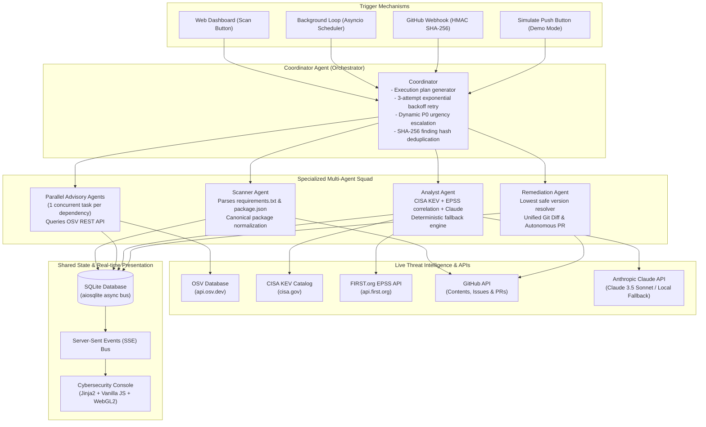
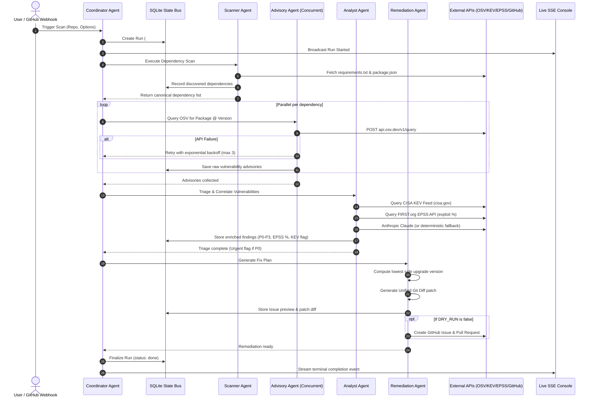

# Vulnerability Watch

An autonomous multi-agent security remediation system that inspects software repositories, queries live vulnerability intelligence, prioritizes active threats using the **CISA Known Exploited Vulnerabilities (KEV)** catalog and **FIRST.org EPSS** exploit probabilities, and automatically generates concrete GitHub remediation plans with lowest-risk safe versions, unified git diff patches, and autonomous Pull Requests.

```
+-----------------------------------------------------------------------------------------+
|                                  Vulnerability Watch                                    |
|   Point it at a repo -> Multi-Agent Squad Triages OSV + CISA KEV + EPSS -> Auto-PR Fix  |
+-----------------------------------------------------------------------------------------+
```

---

## The Problem

Modern software development organizations face a critical **vulnerability alert fatigue crisis**:

1. **Noise Over Signal:** Standard automated scanners (Dependabot, Snyk, generic SCA tools) flood developer inboxes with hundreds of raw CVE alerts based purely on CVSS severity.
2. **Exploitation Reality Mismatch:** Studies show that **only ~2% to 4% of all published CVEs are ever actively weaponized in the wild**. An unexploitable CVSS 9.8 in a development utility often paralyzes engineering teams, while an actively exploited CVSS 7.2 zero-day in production gets ignored in the backlog.
3. **Broken Auto-Updates:** Naive automated PRs bump dependencies to latest major versions, frequently breaking APIs, introducing breaking changes, and forcing developers to reject or ignore automated security fixes.
4. **Manual Triage Bottleneck:** Security engineers spend hours manually cross-referencing CVE numbers, National Vulnerability Database (NVD) entries, CISA advisory catalogs, and version changelogs just to determine if a vulnerability actually matters.

---

## The Solution

**Vulnerability Watch** replaces noisy scanner dumps with an **autonomous squad of specialized AI agents** that behave like an experienced application security engineering team:

- **True Risk Prioritization:** Correlates every identified vulnerability with live feeds from the **CISA Known Exploited Vulnerabilities (KEV)** catalog and **FIRST.org EPSS (Exploit Prediction Scoring System)**. Actively exploited vulnerabilities are instantly escalated to **P0 (URGENT)**.
- **Lowest Safe Version Resolution:** Rather than naively upgrading to the latest bleeding-edge version, the system calculates the minimal safe version that resolves all advisories while minimizing breaking API changes.
- **Autonomous Remediation:** Generates copy-paste upgrade commands, a complete **unified git diff patch**, and can autonomously submit a prioritized **GitHub Pull Request** and **Issue**.
- **Resilient Multi-Agent Architecture:** Governed by an autonomous Coordinator with 3-attempt exponential backoff retries, SHA-256 finding deduplication, zero-dependency graceful exits, and failure-injection testing modes.
- **Cybersecurity Console Dashboard:** Server-rendered Jinja2 interface with dark theme, real-time Server-Sent Events (SSE) streaming timeline, ambient WebGL ASCII radar, and zero npm or React build-step overhead.

---

## System Architecture



---

## End-to-End Workflow



---

## Multi-Agent Roster

| Agent | Core Responsibility | Tools & Intelligence Sources | Autonomy & Resilience Rules |
|---|---|---|---|
| **Coordinator** | Orchestrates run lifecycle, builds execution DAG, spawns subtasks, tracks state, and finalizes runs. | SQLite (`runs`, `tasks`, `findings`, `events`), SSE EventBus | • Handles clean exits on 0 deps or 0 vulns without error.<br>• Retries failed tasks up to 3 times with exponential backoff.<br>• Dynamically escalates run status to `URGENT` upon encountering P0 vulnerabilities.<br>• Suppresses duplicate issues using SHA-256 finding hashes. |
| **Scanner** | Fetches repository manifests, parses pinned packages, and outputs normalized dependencies. | GitHub Contents API, regex manifest parsers, `demo/` offline fallback | • Supports `requirements.txt` (PyPI) and `package.json` (npm).<br>• Gracefully ignores comments, wildcards, and non-pinned ranges.<br>• Falls back to bundled vulnerable fixtures for offline evaluation. |
| **Advisory** | Spawned concurrently (1 async worker per package). Queries vulnerability advisories for exact versions. | OSV REST API (`api.osv.dev`), `packaging.version`, `cvss` vector parser | • Concurrent async requests via `httpx`.<br>• Catches transient network errors; Coordinator retries failed attempts.<br>• Degrades gracefully without halting remaining package checks. |
| **Analyst** | Evaluates true exploitability, correlates CVEs with known attack databases, and assigns P0–P3 priorities. | CISA KEV catalog, FIRST.org EPSS API, Anthropic SDK (Claude 3.5 Sonnet) | • **Deterministic Fallback Engine:** If no Anthropic API key is provided, applies rule-based tiering (`in_kev` or CVSS&ge;9 = P0, EPSS&ge;0.2 or CVSS&ge;7 = P1, CVSS&ge;4 = P2, else P3). Zero external keys required for evaluation. |
| **Remediation** | Resolves lowest safe upgrade versions, generates unified Git diff patches, and opens autonomous GitHub PRs. | OSV version ranges, `packaging.version`, GitHub Issues & PR API | • Computes minimal breaking-change upgrade paths.<br>• Generates unified diffs (`+` / `-`) for instant patching.<br>• Provides copy-paste `pip install` and `npm install` instructions.<br>• Supports `DRY_RUN=true` for safe local testing. |

---

## Priority & Severity Matrix

Vulnerability Watch classifies every finding into four actionable tiers based on active weaponization rather than theoretical severity alone:

| Priority | Criteria | Meaning | Action Taken |
|:---:|---|---|---|
| <span style="color:#FF4D5E; font-weight:bold;">P0</span> | **In CISA KEV** OR (CVSS &ge; 9.0 + EPSS &ge; 0.20) | **Active Weaponization / Zero-Day** | Escalates run to `URGENT`, triggers immediate notification, prioritized at top of fix plan. |
| <span style="color:#FF8A3D; font-weight:bold;">P1</span> | CVSS &ge; 7.0 OR EPSS &ge; 0.20 (80th+ percentile) | **High Exploitation Risk** | Flagged as high priority fix in current sprint remediation cycle. |
| <span style="color:#F5C542; font-weight:bold;">P2</span> | CVSS &ge; 4.0 &ndash; 6.9 | **Medium Severity** | Scheduled for routine patch maintenance. |
| <span style="color:#7D8896; font-weight:bold;">P3</span> | CVSS &lt; 4.0 OR unrated advisory | **Low Severity** | Informational backlog update. |

---

## 5-Step Quickstart (Demo Ready in < 2 Minutes)

Zero external API keys required. The system works completely out of the box using live OSV vulnerability queries, public CISA KEV feeds, public EPSS endpoints, and bundled `demo/` package fixtures.

### 1. Clone the repository
```bash
git clone https://github.com/TARUN-AM/TroubleMakers.git
cd TroubleMakers
```

### 2. Set up a Python virtual environment
```bash
python -m venv .venv

# On Linux/macOS:
source .venv/bin/activate

# On Windows (PowerShell):
.\.venv\Scripts\Activate.ps1
```

### 3. Install dependencies
```bash
pip install -r requirements.txt
```

### 4. Create your environment configuration
```bash
# On Linux/macOS:
cp .env.example .env

# On Windows:
copy .env.example .env
```
*(By default, `DRY_RUN=true` is enabled, allowing complete end-to-end testing without needing a GitHub token or Anthropic API key).*

### 5. Launch the application
```bash
uvicorn app.main:app --reload --host 127.0.0.1 --port 8000
```
Open **[http://localhost:8000](http://localhost:8000)** in your browser:
1. Enter `demo/vulnerable-app` in the repository input.
2. *(Optional)* Check **"Demo: Inject transient failure on 1st Advisory attempt"** to watch the autonomous retry loop in real time.
3. Click **Scan** to watch the multi-agent squad execute across the live SSE terminal console!

---

## 1-Click Cloud Deployment (Render Blueprint)

Vulnerability Watch includes a pre-configured `render.yaml` blueprint for zero-config deployment to [Render](https://render.com):

1. Go to your **[Render Dashboard](https://dashboard.render.com)**.
2. Click **New +** &rarr; **Blueprint**.
3. Connect your repository: **`TARUN-AM/TroubleMakers`**.
4. Render automatically detects `render.yaml`, sets Python 3.12, installs requirements, and configures the start command:
   ```bash
   uvicorn app.main:app --host 0.0.0.0 --port $PORT
   ```
5. Click **Apply** to deploy your live cybersecurity console.
6. Once live, configure your GitHub repository webhook pointing to `https://<your-app>.onrender.com/webhook/github`.

---

## Live GitHub Integration & Webhooks

To scan live repositories on GitHub and automatically create real Issues and Pull Requests:

### 1. Configure GitHub Token
Edit `.env`:
```env
GITHUB_TOKEN=ghp_yourPersonalAccessTokenHere
DRY_RUN=false
```
*Required token scope:* `repo` (for private repositories) or `public_repo` (for public repositories).

### 2. Configure GitHub Push Webhook
1. Go to your GitHub repository &rarr; **Settings** &rarr; **Webhooks** &rarr; **Add webhook**.
2. **Payload URL:** `https://your-domain.com/webhook/github`
3. **Content type:** `application/json`
4. **Secret:** Set to your `GITHUB_WEBHOOK_SECRET` value from `.env` (default: `demo_webhook_secret`).
5. **Events:** Select "Just the `push` event".
6. Every `git push` modifying `requirements.txt` or `package.json` will trigger an autonomous scan and generate remediation plans.

*(To test webhooks without a public domain, click the **Simulate push** button on the dashboard).*

---

## Configuration Reference

| Environment Variable | Default Value | Purpose |
|---|---|---|
| `PORT` | `8000` | Port for the Uvicorn web server |
| `HOST` | `127.0.0.1` | Network interface host |
| `DATABASE_PATH` | `vulnerability_watch.db` | SQLite database file location |
| `GITHUB_TOKEN` | `""` | GitHub Personal Access Token for repository contents, Issues, and PRs |
| `GITHUB_WEBHOOK_SECRET` | `demo_webhook_secret` | HMAC secret for verifying GitHub push webhook payloads |
| `ANTHROPIC_API_KEY` | `""` | Anthropic API key (optional; system uses deterministic fallback if absent) |
| `ANTHROPIC_MODEL` | `claude-sonnet-5-5` | Anthropic Claude model identifier |
| `SCAN_INTERVAL_MIN` | `60` | Background loop interval in minutes for re-scanning watched repositories |
| `DRY_RUN` | `true` | When `true`, previews issues and diffs locally without posting to GitHub |
| `DEMO_INJECT_FAILURE` | `false` | When `true`, artificially fails the first advisory worker to demonstrate retries |

---

## Verification & Test Suite

All 28 unit and integration tests verify autonomous rules, version calculations, live threat intelligence feeds, diff generation, and edge cases:

```bash
pytest -v tests/
```

Test coverage includes:
- Manifest parsing for Python (`requirements.txt`) and Node.js (`package.json`)
- OSV query responses and CVSS vector score calculations
- Lowest safe version resolution using `packaging.version`
- CISA KEV catalog downloads and caching
- FIRST.org EPSS exploit probability and percentile queries
- Anthropic Claude batching and deterministic fallback logic
- Autonomous Git diff generation and Pull Request creation
- Coordinator autonomy: 3-attempt exponential retry, P0 urgency escalation, 0-dep/0-vuln exits, and SHA-256 duplicate suppression
- Constant-time HMAC SHA-256 webhook verification
- REST API and Server-Sent Events (SSE) streaming endpoints

---

## Hackathon Evaluation Mapping

| Judging Criteria | Weight | How Vulnerability Watch Delivers |
|---|---|---|
| **Autonomous Execution** | **25%** | Self-directed multi-agent pipeline: handles zero dependencies/vulnerabilities cleanly, retries transient failures with exponential backoff (max 3), suppresses duplicate open issues via SHA-256 finding hashes, and dynamically escalates urgency upon detecting active CISA KEV exploits. |
| **Problem Relevance** | **20%** | Solves alert fatigue by filtering the 98% of harmless CVEs and highlighting true in-the-wild threats using CISA KEV and EPSS probabilities. Resolves lowest safe upgrade versions to prevent breaking API updates. |
| **Multi-Agent Workflow** | **20%** | 5 distinct agents with specialized roles communicating asynchronously through typed SQLite records and real-time SSE broadcasts. Parallel Advisory agents run concurrently per package. |
| **Tools & Integrations** | **15%** | Production integrations with real APIs: Google OSV REST API (`api.osv.dev`), CISA KEV Catalog, FIRST.org EPSS API, GitHub Contents/Issues/PR REST API, and Anthropic Claude SDK with HMAC webhook security. |
| **Demo Quality** | **10%** | Dark cybersecurity console design with subtle dot-grid, pulsing live status dots, real-time terminal cursor log, ambient WebGL ASCII radar, and instant 1-click failure-injection and push-simulation demo modes. |
| **Architecture & Engineering** | **10%** | Asynchronous Python 3.12+ stack (`FastAPI`, `httpx`, `aiosqlite`, `asyncio`), clean separation of concerns, strict typed interfaces, zero npm/React dependencies, and 28 passing regression tests. |

---

## License

MIT License. Built for hackathon evaluation and open-source software supply chain defense.
